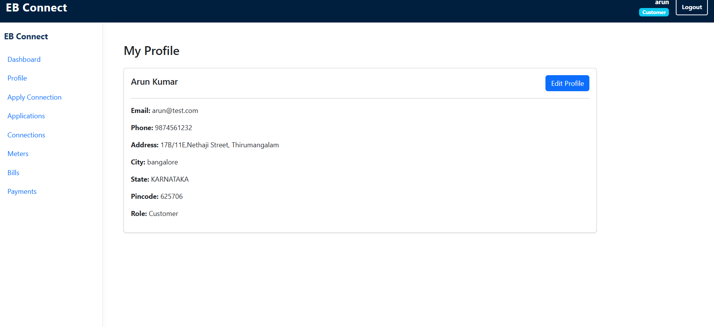
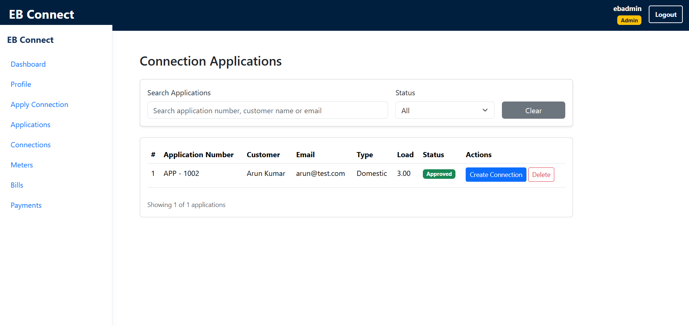
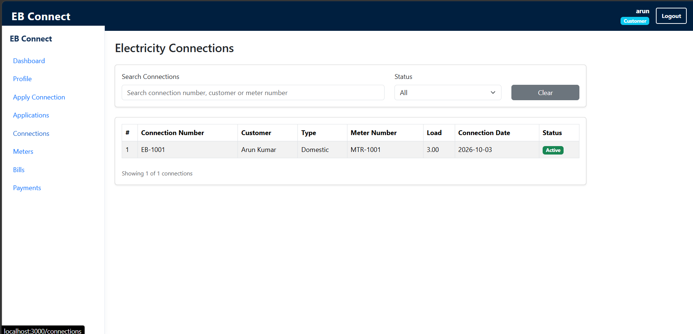

# EB-Connect – Electricity Board Connections

A full-stack web application for managing electricity connection applications, customers and connections.

## Tech Stack

- **Frontend:** React, React Bootstrap
- **Backend:** Python, Django, Django REST Framework
- **Database:** SQLite
- **Authentication:** JWT
- **API:** REST API

## Features

- User and Admin Login
- Role-based access control
- Customer profile management
- Apply for electricity connections
- Admin approval and rejection of applications
- Connection management
- Responsive dashboard

## Screenshots

### User Page


### Admin Page


### Electricity Connections


## Installation

**Frontend**
```bash
cd frontend
npm install
npm start
```

**Backend**
```bash
cd backend
pip install -r requirements.txt
python manage.py migrate
python manage.py runserver
```

>>Note: This project was developed for **learning purposes** to practice full-stack web development using React and Django.

